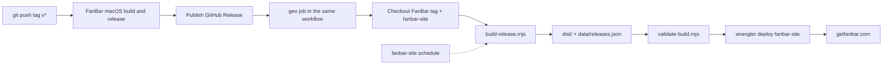

# FanBar GEO release automation

Builds and deploys the FanBar release notes and generative-engine discovery files for
[getfanbar.com](https://getfanbar.com) whenever a new GitHub Release is published.

## What it generates

For the release being built (and any newer release note documents present in the tag):

- `/releases/{v}` and `/zh/releases/{v}` — static HTML release pages with canonical URLs,
  hreflang pairs, Open Graph/Twitter metadata, and `TechArticle` + `BreadcrumbList` JSON-LD
- `/releases/{v}.md` and `/zh/releases/{v}.md` — machine-readable release notes
- Updated `/releases`, `/zh/releases`, `/releases.xml`, `/sitemap.xml`
- Updated `/llms.txt`, `/llms-full.txt` (latest five releases)
- Updated `/api/product.json` and `/api/health.json` (latest version, DMG URLs, exact sizes)
- Updated download buttons, sizes, visible version/date labels, and `SoftwareApplication`
  JSON-LD on every shared page (home pages, safety, compatibility, comparison, blog)

The rest of the site is preserved from the `site/` snapshot. The Cloudflare Worker in
`worker.js` adds the site's existing headers, markdown negotiation, and redirects.

## Architecture



The release event is intentionally not used: FanBar publishes releases with `GITHUB_TOKEN`,
and GitHub suppresses `release: published` workflows for those events. The `geo` job runs in
the same workflow after the release job instead.

## Local build

```sh
GITHUB_TOKEN="$(gh auth token)" \
  node scripts/build-release.mjs --src ../FanBar/docs/releases

node scripts/validate-build.mjs --version 0.8.2
node --test tests/*.test.mjs

npx wrangler dev --local --config wrangler.dev.jsonc --compatibility-date 2026-07-28
node scripts/verify-deployment.mjs http://127.0.0.1:8787
```

`--src` points at a FanBar checkout's `docs/releases/` directory. The build fetches release
metadata (publication time and exact asset sizes) from the GitHub API and falls back to
`data/releases.json` if the API is unavailable.

Use the production compatibility date (`2026-10-13`) for deploys; older local `workerd`
builds reject it. `verify-deployment.mjs` checks every sitemap page plus every referenced
same-origin image/font, which catches missing `srcset` variants.

## Dev and production

- Dev worker: `fanbar-site-dev` (`wrangler.dev.jsonc`), deployed by the release trigger,
  schedule, and backfill workflows. It returns `X-Robots-Tag: noindex, nofollow` so the
  preview cannot be indexed as duplicate content.
- Production worker: `fanbar-site` (`wrangler.jsonc`), deployed only by the manual
  `promote-production.yml` workflow after `confirm=production`.

Promote after verifying the dev Worker:

```sh
gh workflow run promote-production.yml -R helson-lin/fanbar-site \
  -f tag=v0.8.2 -f confirm=production
```

## GitHub Actions

Two workflows live in this repository:

| Workflow | Trigger | Purpose |
| --- | --- | --- |
| `geo-release.yml` | `workflow_dispatch`, `repository_dispatch`, daily schedule | Build + deploy to dev |
| `backfill.yml` | `workflow_dispatch` with comma-separated tags | Rebuild historical releases to dev |
| `promote-production.yml` | manual, with `confirm=production` | Build + deploy to production |

The `geo` job appended to FanBar's `.github/workflows/macos-release.yml` runs only on
`v*` tags after the `release` job and deploys the **dev** Worker (`fanbar-site-dev`).
Production is never deployed automatically; use `promote-production.yml` from the Actions
tab after checking the dev URL.

Required repository secrets (both repositories if both workflows run):

| Secret | Value |
| --- | --- |
| `CLOUDFLARE_API_TOKEN` | Token with Workers Scripts:Edit for the account that owns `fanbar-site` |
| `CLOUDFLARE_ACCOUNT_ID` | Cloudflare account ID |

## Initial backfill

```sh
gh workflow run backfill.yml -R helson-lin/fanbar-site -f tags=v0.8.1,v0.8.2
```

Tags are processed oldest first; the last build is deployed.

## Maintenance

`site/` is a snapshot of the deployed static site, not the original Astro source. After a
deliberate design change to the site:

```sh
node scripts/refresh-baseline.mjs
```

This re-crawls the public site into `site/`, including `src`, `srcset`, `poster`, and CSS
`url()` assets, and regenerates `templates/release.{en,zh}.html` from the newest release
page. Review and commit the snapshot. The generator itself only
depends on the template shell and the release markdown format.

## Layout

```
data/releases.json          release index catalog (highlights, dates, downloads)
site/                       static site snapshot
templates/                  release-page shells with {{ARTICLE}} placeholder
scripts/build-release.mjs   build entry point
scripts/validate-build.mjs  post-build assertions
scripts/refresh-baseline.mjs  refresh snapshot + templates from the live site
scripts/lib/                parser and renderer
worker.js                   site Worker (assets + headers/rewrites)
wrangler.jsonc              Worker and assets configuration
```
